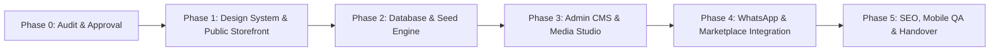

# BellaWoman — Phase 0 Project Audit & Architecture Report

**Document Version:** 1.0  
**Date:** 19 November 2026  
**Status:** Submitted for User Approval  
**Project:** BellaWoman Fashion Product Showcase & Social Commerce Platform  

---

## 1. Executive Summary & Brand Profile

BellaWoman is a modern, fashion-forward women’s apparel brand launching initially with a premier **Activewear** collection (specifically high-performance sports bras, seamless wear, and athleisure tops).

### Brand Identity & Design System
- **Tone:** Energetic, confident, premium, Gen Z fashion-forward, editorial, and product-first.
- **Color Palette (extracted directly from vector logo assets):**
  - **Brand Poppy Accent:** `#FF312C` (Vibrant electric poppy / coral red)
  - **Brand Deep Teal:** `#06262B` (Mineral ink / deep forest teal)
  - **Warm Editorial Canvas:** `#FAF9F5` / `#F7F5F0` (Soft warm sand/alabaster)
  - **Card Surface:** `#FFFFFF` with soft neutral borders `#EAE8E3`
  - **Text Neutral:** `#18181B` (Zinc 900) for high legibility and WCAG AAA contrast
- **Typography:**
  - Headings: Editorial modern serif font paired with bold geometric styling.
  - Body & Microcopy: Crisp geometric sans (`Plus Jakarta Sans` / `Inter`).
- **Brand Assets In Stock:**
  - Vector SVG logo files (`Bellawomen-default.svg`, `Bellawomen-Logo-Dark-BG.svg`, `Bellawomen-Logo-Orange-BG.svg`, `Logo-Icon-Orange.svg`, `Logo-Icon-Dark.svg`).
  - Favicon sets (16x16, 32x32 in PNG and SVG formats).
  - High-resolution authentic product photographs across 18 verified SKUs (`BR-1012` to `BR-1091`) covering front, back, side, and detail angles.
  - Campaign hero imagery (`image-001.jpg`, `image-002.jpg`, `image-010.jpg`, `image-011.jpg`).

---

## 2. Business Model & Customer Journey

The website operates as an **editorial product showcase and social commerce launchpad**. It deliberately avoids the friction, compliance overhead, and complexity of an on-site shopping cart or payment gateway.

```
+-----------------------------------------------------------------------------------+
|                              BEllAWOMAN STOREFRONT                                |
|  [Announcement Strip] -> [Hero Campaign] -> [Activewear Collection] -> [Detail]  |
+-----------------------------------------+-----------------------------------------+
                                          |
                +-------------------------+-------------------------+
                |                                                   |
                v                                                   v
      [ PRIMARY ACTION A ]                                [ PRIMARY ACTION B ]
           "BUY NOW"                                     "ORDER ON WHATSAPP"
                |                                                   |
                v                                                   v
    Redirect to Configured                              Opens WhatsApp Chat (wa.me)
   Marketplace Listing with                             Pre-filled with product title,
   rel="noopener noreferrer"                            SKU, selected size, colour & URL
        (Meesho / Amazon)                                (BellaWoman Concierge Team)
```

### Strict Non-Goals
1. No shopping cart.
2. No on-site checkout.
3. No payment gateway or sensitive payment data storage.
4. No fake sales countdowns, inventory counts, or unverified star ratings.

---

## 3. Technology Architecture & Stack Confirmation

| Layer | Chosen Technology | Justification |
| :--- | :--- | :--- |
| **Framework** | **Next.js 16 (App Router)** | High-speed Server Components (SSR/SSG), zero-JS catalog hydration, dynamic metadata, native image optimization. |
| **Language** | **TypeScript 5** | Strict type safety across database models, API payloads, and UI components. |
| **Styling** | **Tailwind CSS 4** | Ultra-performant CSS engine, responsive utilities, custom CSS variables for design tokens. |
| **Icons** | **Lucide React** | Crisp, lightweight, modern iconography. |
| **Database** | **SQLite (via Prisma 6.19)** | Zero external daemon requirement for instant local development and staging; effortlessly switches to PostgreSQL in production via connection string. |
| **ORM** | **Prisma ORM 6** | Schema migration history, type-safe queries, seed scripts. |
| **Auth** | **Cryptographic Session Cookies** | HTTP-only, SameSite=Strict cookies with SHA-256 HMAC signature; bcryptjs password hashing; zero vulnerable client auth bundles. |
| **Media Storage** | **Local Static (`public/uploads`)** | Direct multipart upload with MIME verification (`image/jpeg`, `image/png`, `image/webp`), size enforcement (5MB), and pluggable architecture for Cloudinary/S3. |

---

## 4. Application Route Structure

### Public Storefront (`src/app/(store)/`)
- `/` — Homepage: Announcement strip, Hero campaign, Shop by Category, New Drops, Best Sellers, Brand Story, WhatsApp CTA, Footer.
- `/categories` — All Collections directory.
- `/category/[slug]` — Dynamic category listing with size/colour/price filters, sorting, and responsive 2-column mobile grid.
- `/product/[slug]` — Product detail page: Multi-image gallery, variant pickers (size & colour), product specs, Buy on Meesho/Amazon buttons, Order on WhatsApp pre-filled CTA.
- `/about` — Brand heritage, philosophy, and quality craftsmanship statement.
- `/contact` — Direct contact channels, customer support hours, and direct WhatsApp concierge.
- `/privacy-policy` — Transparent privacy policy explaining data practices (no payment data collected).
- `/terms` — Terms and conditions for browsing and marketplace redirection.
- `/not-found` — Branded 404 error page.

### Admin CMS Portal (`src/app/admin/`)
- `/admin/login` — Protected admin login with rate limiting.
- `/admin` — Operational dashboard (total published products, drafts, categories, missing marketplace links).
- `/admin/categories` — Category list, create, edit, sort order, and status toggles.
- `/admin/products` — Product catalogue manager, create/edit form, image gallery reorder, variant configuration (sizes, colours), pricing, merchandising badges.
- `/admin/banners` — Campaign hero banner manager (desktop & mobile images, CTA destination, start/end scheduling).
- `/admin/settings` — Global site settings (WhatsApp number, message templates, announcement strip, contact details, social links).

### API Route Handlers (`src/app/api/`)
- `/api/admin/login` & `/api/admin/logout` — Authentication handlers.
- `/api/admin/upload` — Validated image upload handler.
- `/sitemap.xml` & `/robots.txt` — Automated SEO feeds.

---

## 5. Database Schema (Prisma)

```prisma
datasource db {
  provider = "sqlite"
  url      = env("DATABASE_URL")
}

generator client {
  provider = "prisma-client-js"
}

model Category {
  id               String    @id @default(uuid())
  name             String
  slug             String    @unique
  shortDescription String?
  description      String?
  image            String?
  bannerImage      String?
  status           String    @default("draft") // "draft" | "published"
  isFeatured       Boolean   @default(false)
  sortOrder        Int       @default(0)
  seoTitle         String?
  seoDescription   String?
  createdAt        DateTime  @default(now())
  updatedAt        DateTime  @updatedAt

  products         Product[]

  @@index([status])
  @@index([sortOrder])
}

model Product {
  id                      String    @id @default(uuid())
  name                    String
  slug                    String    @unique
  sku                     String?
  shortDescription        String?
  description             String?
  primaryCategoryId       String
  displayPrice            Float?
  originalPrice           Float?
  currency                String    @default("INR")
  status                  String    @default("draft") // "draft" | "published" | "archived"
  isFeatured              Boolean   @default(false)
  isNewArrival            Boolean   @default(false)
  isTrending              Boolean   @default(false)
  isBestSeller            Boolean   @default(false)
  badgeText               String?
  sortOrder               Int       @default(0)
  whatsappMessageOverride String?
  seoTitle                String?
  seoDescription          String?
  createdAt               DateTime  @default(now())
  updatedAt               DateTime  @updatedAt
  publishedAt             DateTime?

  category                Category  @relation(fields: [primaryCategoryId], references: [id], onDelete: Restrict)
  images                  ProductImage[]
  marketplaceLinks        ProductMarketplaceLink[]
  variants                ProductVariant[]

  @@index([primaryCategoryId])
  @@index([status])
  @@index([sortOrder])
}

model ProductImage {
  id         String   @id @default(uuid())
  productId  String
  imagePath  String
  altText    String?
  sortOrder  Int      @default(0)
  isPrimary  Boolean  @default(false)
  createdAt  DateTime @default(now())

  product    Product  @relation(fields: [productId], references: [id], onDelete: Cascade)

  @@index([productId])
  @@index([sortOrder])
}

model ProductMarketplaceLink {
  id              String   @id @default(uuid())
  productId       String
  marketplaceName String   // "Meesho" | "Amazon" | "Flipkart" | Custom
  marketplaceUrl  String
  isEnabled       Boolean  @default(true)
  sortOrder       Int      @default(0)
  createdAt       DateTime @default(now())
  updatedAt       DateTime @updatedAt

  product         Product  @relation(fields: [productId], references: [id], onDelete: Cascade)

  @@index([productId])
  @@index([sortOrder])
}

model ProductVariant {
  id         String   @id @default(uuid())
  productId  String
  size       String?  // e.g. "XS", "S", "M", "L", "XL"
  colour     String?  // e.g. "Poppy Red", "Mineral Teal", "Charcoal", "Sage"
  material   String?
  attributes String?  // JSON string
  sortOrder  Int      @default(0)

  product    Product  @relation(fields: [productId], references: [id], onDelete: Cascade)

  @@index([productId])
  @@index([sortOrder])
}

model Banner {
  id           String    @id @default(uuid())
  title        String
  subtitle     String?
  desktopImage String
  mobileImage  String?
  altText      String?
  ctaLabel     String?
  ctaType      String?   // "category" | "product" | "external" | "whatsapp"
  ctaTarget    String?
  status       String    @default("draft") // "draft" | "published"
  startAt      DateTime?
  endAt        DateTime?
  sortOrder    Int       @default(0)
  createdAt    DateTime  @default(now())
  updatedAt    DateTime  @updatedAt

  @@index([status])
  @@index([sortOrder])
}

model SiteSetting {
  id           String   @id @default(uuid())
  settingKey   String   @unique
  settingValue String
  updatedAt    DateTime @updatedAt
}

model AdminUser {
  id           String    @id @default(uuid())
  name         String
  email        String    @unique
  passwordHash String
  role         String    @default("admin")
  status       String    @default("active")
  lastLoginAt  DateTime?
  createdAt    DateTime  @default(now())
  updatedAt    DateTime  @updatedAt
}
```

---

## 6. WhatsApp & Marketplace Redirection Logic

### A. WhatsApp Link Generation Utility (`lib/whatsapp.ts`)
- Cleans and strips non-digits: `phone.replace(/[^0-9]/g, '')`.
- Validates country code prefix (e.g. `91` for India).
- Builds formatted message:
  ```text
  Hi BellaWoman! I'm interested in ordering:
  Product: [Product Name] (SKU: [SKU])
  Size: [Selected Size]
  Colour: [Selected Colour]
  Price: ₹[Price]
  Link: https://bellawoman.com/product/[slug]
  
  Please let me know about availability and ordering details!
  ```
- Encodes URI and generates: `https://wa.me/[phone]?text=[encoded_text]`.

### B. Marketplace Redirection & Outbound Tracking
- All marketplace buttons render as secure external links:
  `target="_blank" rel="noopener noreferrer"`.
- Buttons only render when a valid, enabled URL exists in the database.
- If only Meesho is configured -> Displays prominent `Buy on Meesho` CTA.
- If both Meesho and Amazon are configured -> Displays split choice buttons with official brand logos.
- If no marketplace link exists -> WhatsApp CTA automatically expands to full width as the primary action (no dead/disabled buttons).

---

## 7. Inventory of Assets & Missing Information

### Verified Assets Present
1. `Bellawomen-logo-files`:
   - High-resolution SVG vectors for light and dark backgrounds.
   - Vector logo icon badges.
   - Multi-resolution Favicons.
2. `Photo/01`:
   - 80 high-quality activewear photography files across 19 SKUs.

### Information Required for Production (Placeholders used during Dev)
1. **Official WhatsApp Business Phone Number** (Configured as `+919876543210` in site settings; admin can edit anytime).
2. **Official Meesho / Amazon Storefront Links** (Using standard demo links during development; admin can enter real listing URLs per product).
3. **Official Contact Email & Studio Address** (Configured in Site Settings as `support@bellawoman.com`).
4. **Cloudinary / Remote Storage API Keys** (Optional: local file storage is fully operational).
5. **Production PostgreSQL Database URL** (Optional: SQLite handles local development and staging seamlessly).

---

## 8. Step-by-Step Implementation Roadmap



- **Phase 1 (Public Storefront):** Implement brand design tokens, header, navigation, announcement strip, footer, Home, Categories, Category Detail, Product Detail, About, and Contact pages with interactive mock data.
- **Phase 2 (Database & Seeding):** Apply Prisma migrations, seed Activewear category and 19 real SKU products using the authentic photographs from `Photo/01`, create default admin user and site settings.
- **Phase 3 (Admin CMS):** Implement `/admin` dashboard, Category CRUD, Product CRUD with image gallery reordering, marketplace URL manager, and banner/settings manager.
- **Phase 4 (Integrations):** Verify WhatsApp pre-filled generation with size/colour options, Meesho/Amazon outbound links, and search/filter engine.
- **Phase 5 (SEO & Production Polish):** Generate `sitemap.xml`, `robots.txt`, OpenGraph cards, JSON-LD product discovery schemas, conduct responsive mobile audit (320px to 1440px), and finalize deployment guide.
